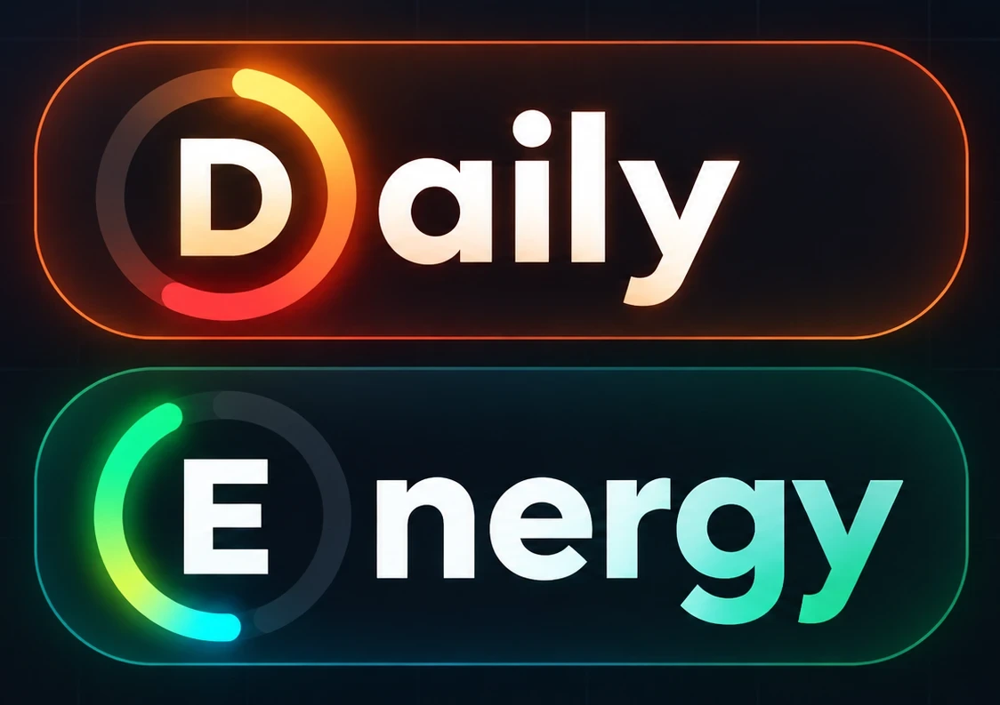
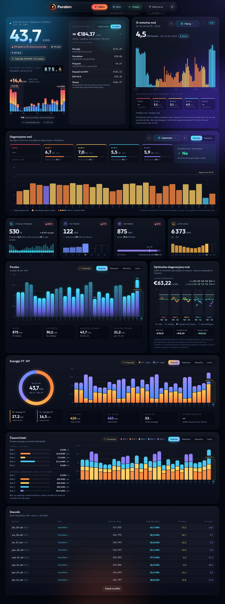

<b>Slovenščina</b> · <a href="#daily-energy-for-moj-elektro">English</a>

# Dnevni pregled porabe za Moj Elektro

Pregled porabe energije za Home Assistant. Podatke hrani in vsako jutro prenese iz Moj Elektro [porabim.com](https://porabim.com); integracija v Home Assistantu pokaže njegovo nadzorno ploščo.

## Funkcije

- Včerajšnja poraba v primerjavi s 30-dnevnim povprečjem
- Grafi dnevne, tedenske, mesečne in letne porabe
- Ločen prikaz VT / MT
- Tarifni bloki 1–5
- Moč v 15-minutnih intervalih z najvišjo vrednostjo za posamezen blok
- Toplotni zemljevid vzorca porabe
- Celotna zgodovina podatkov iz Moj Elektro za poljubno časovno obdobje
- Oddaja energije v omrežje za sončne elektrarne (izbirno)
- Slovenščina ali angleščina
- Lahek način za tablice na steni
- Vrstica z gumbi na vrhu na računalniku, ob levem robu na tablici, zavihki na dnu na telefonu
- Entitete za vsako merilno mesto: odjem in oddaja (zadnji dan, ta mesec, prejšnji mesec), bloki, najvišja moč, dogovorjena moč, ocena računa in elektrarna, za avtomatizacije in nadzorne plošče

## Zahteve

- Home Assistant 2024.12+
- Integracija **My Home Assistant** (del `default_config`)
- API-žeton Moj Elektro: [mojelektro.si](https://mojelektro.si) → Moj profil → **Kreiraj žeton** (neomejena veljavnost)
- ID merilnega mesta (EIMM): Merilna mesta / merilne točke, npr. `4-123456`

## Namestitev

1. Kliknite zgornji gumb → **Download** → ponovno zaženite Home Assistant
2. Dodajte integracijo **Daily Energy for Moj Elektro** → odpre se porabim.com → vnesite ID merilnega mesta in API-žeton → **Poveži** → nazaj v Home Assistantu se **Daily Energy** prikaže v stranski vrstici

   

Brez gumba

HACS → ⋮ → **Custom repositories** → `https://github.com/Sabotin/Daily-Energy-MojElektro` (Integration) → download →
restart → Settings → Devices & services → **Add integration** → **Daily Energy for Moj Elektro**.

## Nastavitve

**Integracija** (Settings → Devices & services → Daily Energy → Configure): prikaz v stranski vrstici. PIN, merilno mesto in API-žeton nastavite na porabim.com.

**Nadzorna plošča** (⚙):

| | |
|---|---|
| Jezik | Samodejno, English ali Slovenščina (za vsako napravo posebej) |
| Omrežje | Odjem, ali Odjem in oddaja |
| Ta naprava | Samodejno, Lahek ali Poln (za vsako napravo posebej) |
| Zgodovina Moj Elektro | Uvoz poljubnega časovnega obdobja |
| Cene | Cena VT / MT za oceno stroškov |
| Vaši podatki | Izvoz, uvoz CSV / JSON, brisanje vseh podatkov |

## Dobro je vedeti

- Novi podatki se preverjajo vsako uro. Včerajšnji 15-minutni podatki so običajno na voljo okoli 06:00, skupna poraba števca (z VT / MT) pa šele naslednji dan. Do takrat se včerajšnja poraba prikazuje na podlagi 15-minutnih podatkov.
- Podatki in API-žeton Moj Elektro so shranjeni na porabim.com ([zasebnost](https://porabim.com/zasebnost)). Home Assistant hrani samo ključ za porabim.com, ki ne pride do brskalnika.
- Nadgradnja z različice 1: Home Assistant vas prosi, da se povežete s porabim.com (Popravila → **Poveži s porabim.com**). Po prvi povezavi se vaš dnevnik enkrat naloži na porabim.com in izbriše iz Home Assistanta.
- Več merilnih mest (največ 3): vsa so v istem računu in v istem vnosu v stranski vrstici. Dodate jih z gumbom **+** v plošči Daily Energy ali z **Dodaj integracijo** (vpišete merilno mesto in žeton) – oboje deluje enako.
- Home Assistant ima na porabim.com en račun. Ostane isti tudi, če integracijo izbrišete in dodate znova.
- Ko izbrišete integracijo, se povezava na porabim.com prekine. Za ponovno povezavo uporabite eno od merilnih mest v računu.
- **Izbriši račun** v nastavitvah plošče izbriše račun na porabim.com in hkrati integracijo iz Naprave in storitve. Če je bil račun izbrisan drugje, se ob ponovni povezavi vnos premakne v novi račun.

## Licenca

Vse pravice pridržane – glejte [LICENSE](LICENSE). Projekt ni povezan z Elektro Slovenije ali katerim koli distribucijskim podjetjem.

---

<a href="#dnevni-pregled-porabe-za-moj-elektro">Slovenščina</a> · <b>English</b>

# Daily Energy for Moj Elektro

Energy dashboard for Home Assistant. [porabim.com](https://porabim.com) keeps the data and fetches it from Moj Elektro every morning; the integration shows its dashboard in Home Assistant.

## Features

- Yesterday's usage vs. your 30-day average
- Daily, weekly, monthly and yearly charts
- VT / MT split
- Tariff blocks 1–5
- 15-minute power with the peak per block
- Energy rhythm heat map
- Full history from Moj Elektro, any date range
- Grid out for solar panels (optional)
- English or Slovenian
- Light mode for wall tablets
- Top bar on PC, side rail on tablets, bottom tabs on phones
- Entities for every meter: grid in and out (last day, this month, last month), blocks, peak power, agreed power, bill estimate and solar plant, for automations and dashboards

## Requirements

- Home Assistant 2024.12+
- The **My Home Assistant** integration (part of `default_config`)
- Moj Elektro **API token**: [mojelektro.si](https://mojelektro.si) → Moj profil → **Kreiraj žeton** (unlimited expiration)
- **Meter ID** (EIMM): Merilna mesta / merilne točke, e.g. `4-123456`

## Install

1. Click the button above → **Download** → restart Home Assistant
2. Add the integration → porabim.com opens → enter your meter ID and API token → **Poveži** → back in Home Assistant, **Daily Energy** appears in the sidebar

   

Without the button

HACS → ⋮ → **Custom repositories** → `https://github.com/Sabotin/Daily-Energy-MojElektro` (Integration) → download →
restart → Settings → Devices & services → **Add integration** → **Daily Energy for Moj Elektro**.

## Settings

**Integration** (Settings → Devices & services → Daily Energy → Configure): sidebar. PIN, meter and API token are set on porabim.com.

**Dashboard** (⚙):

| | |
|---|---|
| Language | Automatic, English or Slovenščina (per device) |
| Grid | Grid in, or Grid in & Grid out |
| This device | Automatic, Light or Full (per device) |
| Moj Elektro history | Import any date range |
| Prices | VT / MT price for cost estimates |
| Your data | Export, import CSV / JSON, delete all data |

## Good to know

- New data is checked every hour. Yesterday's 15-minute data arrives at about 06:00, the meter total (with VT / MT) a day later – until then yesterday is shown from the 15-minute data.
- Your data and Moj Elektro token are stored on porabim.com ([privacy](https://porabim.com/zasebnost)). Home Assistant keeps only the porabim.com key, which never reaches the browser.
- Upgrading from version 1: Home Assistant asks you to connect to porabim.com (Repairs → **Connect to porabim.com**). After the first connection your day log is uploaded to porabim.com once and deleted from Home Assistant.
- Several meters (up to 3): all in the same account and the same sidebar item. Add them with **+** in the Daily Energy panel or with **Add integration** (meter ID and token) – both do the same.
- Home Assistant has one account on porabim.com. It stays the same when you delete the integration and add it again.
- Deleting the integration ends its link on porabim.com. To connect again, use one of the meters in the account.
- **Delete account** in the panel settings deletes the porabim.com account and the integration in Devices & services with it. If the account was deleted elsewhere, reconnecting moves the entry to the new account.
- If porabim.com refuses the key (e.g. the account was deleted), Home Assistant asks you once to connect again (Devices & services → Daily Energy → **Reconfigure**) and does not ask porabim.com again until you do; until then the panel and entities show as signed out.

## Licence

All rights reserved – see [LICENSE](LICENSE). Not affiliated with Elektro Slovenije or any distribution company.
